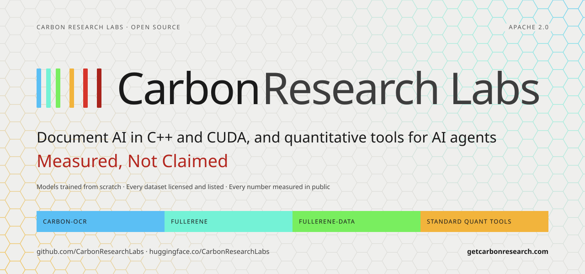
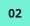

<picture>
  <source media="(prefers-color-scheme: dark)" srcset="assets/banner-dark.svg">
  
</picture>

  
  
  
  
  

**Carbon Research Labs builds open-source software in which every number is measured, never estimated.** Two
projects are public: Carbon-OCR, an OCR engine in C++ and CUDA with its own family of small models, Fullerene; and
Standard Quant Tools, a Python library for quantitative finance, built to be called by AI agents.

##  Carbon-OCR and Fullerene

[**Carbon-OCR**](https://github.com/CarbonResearchLabs/Carbon-OCR) reads scans, photos of documents and PDFs into text,
markdown, HTML and JSON with boxes, in reading order, with labeled blocks and table cells. It runs on CPUs, with its
own int8 kernels or with ONNX Runtime, one worker per core, and on NVIDIA GPUs through TensorRT, with many pages in
flight. It also writes hOCR, ALTO, PAGE XML and searchable PDF.

[**fullerene-3M**](https://huggingface.co/CarbonResearchLabs/fullerene-3M) is its Latin model set, for Latin, Cyrillic
and Greek: four networks with 2.77 M parameters in all, trained from scratch, for page orientation, line detection,
line recognition, and reading order with block labels and table cells. Read by Carbon-OCR, it scores a headline of
**44.5** on all 2,937 pages of OmniParseBench, where Tesseract 5.5 scores 5.9.

[**fullerene-data**](https://huggingface.co/datasets/CarbonResearchLabs/fullerene-data) records the training data
source by source: where each came from, its license, and every file's checksum.

##  Standard Quant Tools

[**Standard Quant Tools**](https://github.com/CarbonResearchLabs/Standard-Tools) is a Python library for quantitative
finance, built to be called by AI agents. Every tool takes one Pydantic model and returns one, so an agent gets
structured data back, and errors that say what to fix. Its 266 tools are split across twelve runtimes, and a client
is served one runtime at a time, over MCP or as function-calling schemas. The CPU-bound paths run in an optional C++
extension behind the same API, with a pure-Python fallback.

##  Licenses

- Carbon-OCR and Standard Quant Tools: Apache 2.0.
- The Fullerene weights: the [Carbon-OCR OpenRAIL-AMS](https://huggingface.co/CarbonResearchLabs/fullerene-3M/blob/main/LICENSE-WEIGHTS.md),
  royalty-free under its use restrictions.

[getcarbonresearch.com](https://getcarbonresearch.com) · [huggingface.co/CarbonResearchLabs](https://huggingface.co/CarbonResearchLabs)
